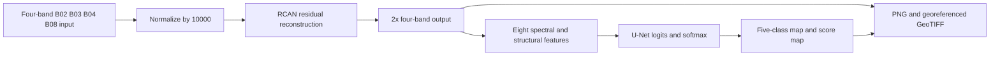

# Deep Learning-Based Super-Resolution Mapping from Medium-Resolution Satellite Imagery

**Team:** Shantanu Vasagadekar (1012412110), Aniruddha Kadam (1012412113), Shrihari Kshirsagar (1012412139).

## Objective and completed scope

Build a reproducible prototype that learns four-band 2x image reconstruction and exports land-cover maps and geospatial rasters. The synthetic experiment uses five classes. The default real detector combines Hugging Face SegFormer-B0 and OpenEarthMap SparseMask/MobileNetV2, with six mapped classes, using the original image independently of enhancement. Its road/building training images are 0.25-0.5 m, so precise detection on 10 m Sentinel-2 remains unvalidated. HF_MODEL.md reports the latest audit: 79.80% pixel accuracy on eight fixed LoveDA images, below the requested 85% threshold. No accuracy guarantee applies to arbitrary inputs.

## Default real-imagery detector

Both real models are pretrained on manually labeled OpenEarthMap imagery. SparseMask retains its BGR normalization; HF SegFormer uses its documented RGB/ImageNet preprocessing, a verified offline TorchScript export and four reflected views in combined mode. Probabilities are averaged equally, with measured-NIR checks only on real four-band inputs. Vegetation classes merge, while developed space remains distinct from roads/buildings. Native maps are replicated for the enhanced display. Standalone HF, previous SparseMask and synthetic U-Net remain selectable. HF_MODEL.md documents licensing, CPU use, class mapping, failed classes and the reproducible audit.

## Synthetic experiment architecture

The model families are adapted from Zhang et al.'s [RCAN paper](https://arxiv.org/abs/1807.02758) and Ronneberger et al.'s [U-Net paper](https://arxiv.org/abs/1505.04597). This project uses smaller architectures and a four-band satellite input contract.

RCAN uses 32 feature channels, three residual groups and four residual channel attention blocks per group. Channel attention combines global average pooling and a two-layer sigmoid gate. PixelShuffle performs 2x upsampling. A bicubic skip provides the initial reconstruction; the trainable branch learns its residual. The reconstruction head starts at zero, so training begins at the bicubic baseline.

U-Net uses encoder widths 32, 64 and 128, a 256-channel bottleneck, transposed-convolution upsampling and skip connections. Its eight inputs are four reflectance channels, NDVI, green/NIR NDWI, red/NIR contrast and luminance gradient magnitude. Red/NIR contrast duplicates negative NDVI and is retained for compatibility; it is not the SWIR-based NDBI. Five output logits represent buildings, roads, vegetation, water and bare land. Softmax scores are uncalibrated.

The synthetic experiment pipeline uses neural predictions directly. Optional morphological processing exists in the segmenter but is disabled in the GUI and measured test experiment to preserve probabilities and thin structures. An explicit spectral-rule baseline is available when no segmentation weights exist.

## Dataset and learning protocol

Procedural scenes contain vegetation regions, soil, a meandering river, building rectangles and intersecting roads. Each class receives a varied four-band spectral signature and independent noise. These signatures and simple shapes make the synthetic learning task substantially easier than real satellite interpretation.

- Training: 128 independent scenes, seed range beginning at 1000.
- Validation: 32 independent scenes, seed range beginning at 100000.
- Test: 32 independent scenes, seed range beginning at 200000.
- HR dimensions: 64x64; LR dimensions: 32x32.
- Degradation: antialiased bicubic downsampling.
- Epochs: 30 per model; batch size: 8; Adam learning rate: 0.001.
- Loss: L1 for reconstruction; cross-entropy for segmentation.
- Gradient clipping: norm 1.0.
- Model selection: minimum validation loss, independently for each task.
- Hardware: NVIDIA GeForce RTX 3070 Ti Laptop GPU; CPU inference also verified.

U-Net learns from ground-truth HR features. For full pipeline evaluation, it receives reconstructed RCAN imagery. The untouched test set is evaluated once after checkpoint selection. Training losses, settings and test confusion matrices are retained in `checkpoints/demo/training_report.json`.

## Real-data RCAN retraining (SEN2VENµS)

The RCAN used by the app was retrained on real cross-sensor pairs: Sentinel-2 10 m patches and same-day VENµS 5 m references from SEN2VENµS. The data split is 17 training sites (41,704 patches), 1 validation site (ALSACE) and 2 held-out Indian test sites (BENGA, KUDALIAR; 13,039 patches). The architecture is unchanged.

A first run (Run A) scored well against VENµS but flattened Sentinel-2 contrast by 5-25% on Indian scenes. The pairs are misregistered by fractions of a pixel, and VENµS has 5-9% less contrast than Sentinel-2 at every scale, so a model fitted to raw VENµS learns blur and contrast loss. The final model (Run B) fixes both:
- each patch's sub-pixel shift (1/8 px) is estimated and applied inside the loss;
- each reference is rescaled per band to Sentinel-2's mean and contrast at 40 m;
- an RMSE consistency term keeps brightness tied to the input.

Of three seeds, the one with the lowest validation loss was selected.

| Held-out Indian sites, 13,039 patches | Bicubic | Synthetic RCAN | Run A | ESA SEN2SRLite | Run B (app) |
| --- | ---: | ---: | ---: | ---: | ---: |
| PSNR gain, harmonised (main) | 0 | −0.26 dB | +0.12 dB | −0.04 dB | **+0.20 dB** |
| Patches better than bicubic | n/a | 2% | 69% | 31% | **83%** |
| PSNR gain, raw | 0 | −0.25 dB | +0.10 dB | −0.07 dB | **+0.11 dB** |
| Indian reduced-scale benchmark (42 scenes) | 0 | −0.63 dB | −1.57 dB | −0.12 dB | **+0.20 dB (38/42)** |

The synthetic model's 5.66 dB gain below did not transfer to real imagery. Run B gives a small, consistent gain (seed spread ±0.04 dB on the test sites) and preserves Sentinel-2 radiometry. It also removes the striping seen in the Compare view. The gain is in line with published 2x results and does not mean sub-10 m objects are recovered. It varies by site (+0.34 dB KUDALIAR, +0.03 dB BENGA). Details, commands and the full tables are in README.md, `results/` and `checkpoints/demo/rcan_training_report.json`.

## Measured held-out synthetic results (original experiment; RCAN kept as `rcan_synthetic.pt`)

| Metric | Bicubic | Trained RCAN |
| --- | ---: | ---: |
| PSNR | 30.08 dB | 35.74 dB |
| SSIM | 0.8928 | 0.9717 |
| SAM | 5.024 degrees | 2.391 degrees |

RCAN improves mean test PSNR by 5.66 dB under the synthetic degradation. The RCAN -> U-Net pipeline achieves 98.13% pixel accuracy and 94.38% mean IoU.

| Class | Full pipeline IoU |
| --- | ---: |
| Buildings | 99.06% |
| Roads | 96.91% |
| Vegetation | 97.47% |
| Water | 81.98% |
| Bare land | 96.48% |

U-Net evaluated directly on HR synthetic inputs reaches 99.995% mean IoU. The gap from full pipeline performance illustrates reconstruction error and input distribution shift. These high values are expected on simple procedural labels and cannot support real-world accuracy claims.

## Metrics and exports

PSNR uses a reflectance data range of 10000. SSIM uses uniform 7x7 local statistics and an average over bands. SAM measures per-pixel spectral angles. Confusion matrices use truth as rows and prediction as columns; label 255 is ignored. Classes absent from both truth and predictions have undefined IoU and are excluded from mean IoU.

GUI uploads have no HR truth, so their PSNR, SSIM and SAM compare enhanced imagery with bicubic interpolation. These are similarity diagnostics. Sharpness and softmax scores are not substitutes for labeled evaluation.

The application preserves CRS, affine transforms and image footprints. Projected pixel area uses the affine determinant and conversion of CRS units to meters. Geographic grids and unreferenced photos have no reported area. RGB NIR is estimated and marked as illustrative. A 2x GeoTIFF has half the pixel spacing while retaining the source footprint; measured resolution improvement is not assumed.

## Verification

The regression suite checks held-out learned behavior, tiny and odd image sizes, probability sums, NoData, strict checkpoint rejection, metric edge cases, dataset formats, geospatial transforms, class-zero preservation and the asynchronous GUI sequence. GeoTIFF -> NPZ -> custom-model training was also exercised with small independently generated scenes. ONNX export was checked and compared numerically with PyTorch at rectangular and odd dimensions.

The main application defaults to CPU and exposes a **Run without GPU (CPU)** toggle. Both trained models run on CPU with bounded thread counts. Device changes load both replacement models before committing, clear stale processed results, preserve the selected source and model folder, and restore working state on failure. CPU-to-GPU-to-CPU checks compare numeric output and verify that old GPU model allocation is released. `setup_cpu.bat` creates an independent CPU-only environment; `run_app.bat` uses it when available. A separate installation using PyTorch's CPU build is verified alongside the CUDA-capable installation; see the audit record for results.

## Limitations and next work

Real satellite validation requires independent geographic scenes, co-registered four-band HR references and five-class labels. Product-specific radiometric scaling and label remapping must be completed before ingestion. Models trained on this synthetic generator should not be used for operational mapping. RCAN has since been retrained on real SEN2VENµS pairs (above). A larger RCAN (checking CPU speed), more Indian test sites and a mapping experiment on Run B outputs are the next steps. Real data should assess class imbalance, boundaries, small objects, domain shift, confidence calibration and tile-context effects. SWIR features, segmentation training on reconstructed inputs, vectorization and geographically balanced evaluation are useful future extensions.

## Reproduction

See `README.md` for installation, demo training, inference, ONNX deployment and real dataset preparation. `requirements-tested.txt` records the package versions used for the included experiment.

## Software audit

See `AUDIT_REPORT.md` for the image-format matrix, repeated-input regression, worker and memory fixes, backend validation, transactional exports and verification record. `demo_images/` now contains five genuine Sentinel-2 L2A crops covering urban, agricultural, vegetation, water and mixed areas. Native B02/B03/B04/B08 pixels, CRS, crop grid, acquisition dates and source attribution are preserved. All five scenes are tested through both GUIs and geographic exports. Generated software format fixtures are under `tests/fixtures/formats/`. The synthetic training metrics above describe RCAN and optional U-Net weights; they do not measure accuracy of the default real-pretrained detector. The real detector is evaluated separately in real_accuracy_report.json, with reference limitations stated explicitly.
