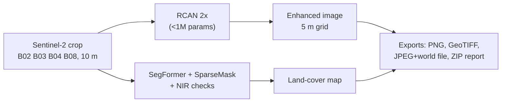

# Sentinel-2 Super-Resolution and Land-Cover Mapping

[](https://github.com/Aniruddha-Kadam-dev/satellite-super-resolution-using-DL/actions/workflows/tests.yml)


An RCAN model that upsamples Sentinel-2 imagery 2x (10 m → 5 m), **trained on real satellite image pairs**, plus a desktop app that turns a satellite crop into a land-cover map and GIS-ready exports.

The project also asks whether super-resolution is worth it. On held-out real data the model beats bicubic interpolation, but only by about half a decibel, and super-resolved input did **not** improve land-cover mapping in our benchmark. Both results are reported below with their limits.


## Results

**Super-resolution on real data.** Sentinel-2 10 m patches are upsampled 2x and scored against same-day 5 m images from the VENµS satellite (SEN2VENµS dataset). The test uses 2,000 patches from two Indian sites that were not used in training.

| Method | PSNR raw | PSNR, registration-compensated | Gain vs bicubic | Patches better than bicubic | SAM |
| --- | ---: | ---: | ---: | ---: | ---: |
| Bicubic | 39.08 dB | 40.09 dB | 0 | n/a | 1.97° |
| RCAN trained on synthetic data | 38.83 dB | 39.80 dB | −0.29 dB | 6 / 2000 | 2.06° |
| **RCAN trained on SEN2VENµS (this repo)** | **39.17 dB** | **40.55 dB** | **+0.47 dB** | **1638 / 2000** | **1.83°** |

- **Synthetic vs real training data.** The same network trained on synthetic data is *worse* than bicubic on real imagery. Training on real pairs turns it into a consistent, though small, improvement, with similar gains at both sites (+0.48 / +0.46 dB).
- **Raw vs compensated.** The two sensors are misregistered by about one 5 m pixel. "Compensated" scores remove the best ±2 px shift and each band's mean offset for every method, as in the PROBA-V challenge's cPSNR. Without that correction the gain is only +0.09 dB.

**Does super-resolution help mapping?** The same U-Net was trained on each input type and scored against ESA WorldCover labels at 8 held-out Indian sites (3 seeds):

| Input | Mean IoU |
| --- | ---: |
| Original 10 m | 47.8% ± 2.2 |
| Bicubic 2x | 49.3% ± 1.6 |
| RCAN 2x (synthetic-trained) | 49.3% ± 2.1 |
| ESA SEN2SR | 48.8% ± 1.8 |

Upsampling helps a little, but bicubic already provides that gain. The differences between methods are smaller than the variation between seeds. WorldCover labels are 10 m, so this test cannot reward detail finer than 10 m. The experiment ran before retraining, so it used the synthetic-trained RCAN. Full write-up: [docs/SR_COMPARISON.md](docs/SR_COMPARISON.md).

**Land-cover detector.** A pretrained SegFormer-B0 + OpenEarthMap SparseMask ensemble with NIR-based corrections reaches 79.8% pixel accuracy on a fixed 8-image LoveDA audit (up from 77.2%). See [docs/LAND_COVER.md](docs/LAND_COVER.md).

## How it works



- **Model:** RCAN (residual channel attention network) with 32 features and 3 residual groups of 4 blocks, plus a bicubic skip connection.
- **Training:** bf16 mixed precision on an 8 GB laptop GPU, with a loss that ignores misregistration (shift- and bias-compensated L1). A weak consistency term keeps the downsampled output equal to the input.
- **Detection input:** land cover is detected from the *original* image, not the enhanced one, because the mapping experiment found no benefit from super-resolved input.
- **Export labelling:** enhanced exports are tagged as derived imagery (GeoTIFF tag `derived_product=true`, PNG/JPEG metadata).
- **Compare view:** the app shows a change-vs-bicubic map, so users can see where the model altered the image.
- **CPU-only option:** an ONNX export runs without PyTorch. The export script checks it against PyTorch on three input sizes.

## Quick start

```bash
git clone https://github.com/Aniruddha-Kadam-dev/satellite-super-resolution-using-DL.git
cd satellite-super-resolution-using-DL
python -m pip install -r requirements.txt
python app.py
```

Pick a **Sentinel-2** sample from the sidebar and press **Run all**. The app runs on CPU by default, and trained weights are included in `checkpoints/demo/`. On Windows you can instead double-click `setup_cpu.bat` once, then `run_app.bat`.

Command-line inference:

```bash
python scripts/predict.py --image demo_images/sentinel2_urban_delhi_2023-12-05.tif --output outputs/delhi
```

## Reproduce the training and evaluation

```bash
python scripts/download_sen2venus.py      # ~17 GB, resumable, MD5-checked
python scripts/prepare_sen2venus.py       # -> datasets/sen2venus_npy/{train,val,test}
python scripts/train.py --task sr --data datasets/sen2venus_npy --output checkpoints/real/runA --epochs 80 --batch-size 16 --crop 96 --lr 2e-4
python scripts/evaluate_sen2venus.py --models old_synthetic=checkpoints/demo/rcan_synthetic.pt new_real=checkpoints/demo/rcan.pt
```

The data is split by site, so no site appears in two splits:

| Split | Sites |
| --- | --- |
| Train | 7 sites |
| Validation | ALSACE |
| Test | BENGA, KUDALIAR (India) |

Training takes about 60 s per epoch on an RTX 5050 Laptop GPU. The mapping experiment and SEN2SR comparison steps are in [docs/SR_COMPARISON.md](docs/SR_COMPARISON.md).

## Tests

```bash
python -m pip install -r requirements/dev.txt
python -m unittest discover -s tests
```

The suite has 103 tests: 97 pass and 6 skip when there is no CUDA GPU or optional SEN2SR install. GitHub Actions runs it on every push. It covers:

- model and metric correctness
- strict checkpoint loading
- ONNX/PyTorch parity
- raster I/O (CRS, transforms, NoData)
- rejecting corrupt uploads
- atomic exports
- end-to-end GUI workflows on the five real Sentinel-2 scenes
- each app starting cleanly in a fresh process

## Repository layout

```text
src/satsr/            library: RCAN, U-Net, detectors, raster I/O, metrics, exports
  models/             RCAN, U-Net, SegFormer/SparseMask wrappers, SEN2SR wrapper
scripts/              command-line tools: train, predict, evaluate, download, prepare
tests/                unittest suite (+ fixtures)
app.py                desktop app (PyQt5, PyTorch)
app_onnx.py           lightweight super-resolution app (ONNX Runtime, no PyTorch)
checkpoints/demo/     trained weights used by the app
demo_images/          five real Sentinel-2 L2A crops with provenance
results/              raw JSON results behind every number above
docs/                 user guide, experiment write-ups, detector notes, related work
```

## Limitations

- **Small gain.** The super-resolution gain is small, which is in line with the literature for 2x on Sentinel-2. The best checkpoint came at epoch 6 of 80; after that the model overfit the 7 training sites, so more training sites are the obvious next step.
- **Narrow test set.** The test covers two sites, both in India.
- **What the gain measures.** VENµS is a different sensor, so the result measures "closer to a real 5 m image", not recovery of objects smaller than 10 m.
- **Comparisons still to run.** ESA's SEN2SR has not yet been scored on the SEN2VENµS test. The mapping experiment has not been re-run with the real-trained RCAN.
- **Derived imagery.** Enhanced images are model output, not measured imagery.
- **No accuracy guarantee for other inputs.** Map accuracy on arbitrary uploads is not guaranteed; see [docs/LAND_COVER.md](docs/LAND_COVER.md).

## Documentation

- [User guide](docs/USER_GUIDE.md): every app feature, custom datasets, the ONNX app, the synthetic experiment
- [SR comparison](docs/SR_COMPARISON.md): all three experiments in detail
- [Land-cover detector](docs/LAND_COVER.md): models, per-class accuracy, spectral checks, limits
- [Related work](docs/RELATED_WORK.md): prior work, competing tools, research frontier

## Authors and credits

Shantanu Vasagadekar, Aniruddha Kadam and Shrihari Kshirsagar.

Data and model credits:

- Contains modified Copernicus Sentinel data (2021–2024).
- SEN2VENµS: Michel et al., 2022, *Data* 7(7):96, CC BY-NC 4.0.
- ESA WorldCover 2021: CC BY 4.0.
- SEN2SRLite (ESA OpenSR): MIT.
- SegFormer via Hugging Face.
- OpenEarthMap SparseMask: see `src/satsr/models/oem_sparsemask/LICENSE`.

Code is licensed under GPL-3.0.
