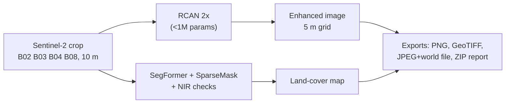

# Sentinel-2 Super-Resolution and Land-Cover Mapping

[](https://github.com/Aniruddha-Kadam-dev/satellite-super-resolution-using-DL/actions/workflows/tests.yml)


An RCAN model that upsamples Sentinel-2 imagery 2x (10 m → 5 m), **trained on real satellite image pairs**, plus a desktop app that turns a satellite crop into a land-cover map and GIS-ready exports.

The project also asks whether super-resolution is worth it. On held-out real data the model beats bicubic interpolation, but only by about 0.2 dB, and super-resolved input did **not** improve land-cover mapping in our benchmark. Both results are reported below with their limits.


## Results

**Super-resolution on real data.** Sentinel-2 10 m patches are upsampled 2x and scored against same-day 5 m images from the VENµS satellite (SEN2VENµS dataset). The test uses all 13,039 patches from two Indian sites (BENGA, KUDALIAR) that were not used in training.

| Method | PSNR gain vs bicubic (main score) | Patches better than bicubic | Raw gain | Indian reduced-scale benchmark (42 scenes) |
| --- | ---: | ---: | ---: | ---: |
| Bicubic (40.54 dB) | 0 | n/a | 0 | 0 |
| RCAN trained on synthetic data | −0.26 dB | 2% | −0.25 dB | −0.63 dB (2 / 42 better) |
| First real-data run (Run A) | +0.12 dB | 69% | +0.10 dB | −1.57 dB (0 / 42) |
| ESA SEN2SRLite | −0.04 dB | 31% | −0.07 dB | −0.12 dB (15 / 42) |
| **RCAN trained on SEN2VENµS (app, Run B)** | **+0.20 dB** | **83%** | **+0.11 dB** | **+0.20 dB (38 / 42)** |

- **Synthetic vs real training data.** The same network trained on synthetic data is *worse* than bicubic on real imagery. Training on real pairs turns it into a consistent, though small, improvement. Three training seeds agree within ±0.04 dB.
- **Main score.** VENµS is offset from Sentinel-2 by fractions of a pixel and has 5–9% less contrast. The main score applies each patch's known sub-pixel shift (the same for every method), removes band offsets and puts the reference on Sentinel-2 contrast. "Raw" applies no correction.
- **Why Run A was replaced.** The first real-data model learned VENµS's lower contrast and flattened Sentinel-2 images by 5–25%, which shows up as −1.57 dB on the reduced-scale benchmark. Run B trains on aligned, contrast-matched references and fixes this. An earlier README figure of "+0.47 dB" came from Run A and an older, more lenient scoring and is withdrawn.
- **Per site.** The gain is uneven: +0.34 dB at KUDALIAR, +0.03 dB at BENGA, and about zero at the validation site ALSACE (France): 38.38 dB vs bicubic's 38.39 dB at the selected epoch. Of the three sites the model never trained on, only KUDALIAR shows a clear gain.

**Does super-resolution help mapping?** The same U-Net was trained on each input type and scored against ESA WorldCover labels at 8 held-out Indian sites (3 seeds):

| Input | Mean IoU |
| --- | ---: |
| Original 10 m | 47.8% ± 2.2 |
| Bicubic 2x | 49.3% ± 1.6 |
| RCAN 2x (synthetic-trained) | 49.3% ± 2.1 |
| ESA SEN2SR | 48.8% ± 1.8 |

Upsampling helps a little, but bicubic already provides that gain. The differences between methods are smaller than the variation between seeds. WorldCover labels are 10 m, so this test cannot reward detail finer than 10 m. The experiment ran before retraining, so it used the synthetic-trained RCAN. Full write-up: [docs/SR_COMPARISON.md](docs/SR_COMPARISON.md).

**Land-cover detector.** A pretrained SegFormer-B0 + OpenEarthMap SparseMask ensemble with NIR-based corrections reaches 79.8% pixel accuracy on a fixed 8-image LoveDA audit (up from 77.2%). See [docs/LAND_COVER.md](docs/LAND_COVER.md).

## How it works



- **Model:** RCAN (residual channel attention network) with 32 features and 3 residual groups of 4 blocks, plus a bicubic skip connection.
- **Training:** bf16 mixed precision on an 8 GB laptop GPU. Each VENµS reference is aligned to Sentinel-2 to 1/8 pixel and rescaled to Sentinel-2 contrast before the L1 loss. An RMSE term keeps the output, downsampled to 10 m, equal to the input.
- **Detection input:** land cover is detected from the *original* image, not the enhanced one, because the mapping experiment found no benefit from super-resolved input.
- **Export labelling:** enhanced exports are tagged as derived imagery (GeoTIFF tag `derived_product=true`, PNG/JPEG metadata).
- **Compare view:** the app shows a change-vs-bicubic map, so users can see where the model altered the image.
- **CPU-only option:** an ONNX export runs without PyTorch. The export script checks it against PyTorch on three input sizes.

## Quick start

```bash
git clone https://github.com/Aniruddha-Kadam-dev/satellite-super-resolution-using-DL.git
cd satellite-super-resolution-using-DL
python -m pip install -r requirements.txt
python app.py
```

Pick a **Sentinel-2** sample from the sidebar and press **Run all**. The app runs on CPU by default, and trained weights are included in `checkpoints/demo/`. On Windows you can instead double-click `setup_cpu.bat` once, then `run_app.bat`.

Command-line inference:

```bash
python scripts/predict.py --image demo_images/sentinel2_urban_delhi_2023-12-05.tif --output outputs/delhi
```

## Reproduce the training and evaluation

```bash
python scripts/download_sen2venus.py      # 20 sites, ~37 GB, resumable, MD5-checked
python scripts/prepare_sen2venus.py       # -> datasets/sen2venus_npy/{train,val,test}, with per-patch shift and contrast
python scripts/train.py --task sr --data datasets/sen2venus_npy --output checkpoints/real/runB_s42 --epochs 25 --early-stop 6 --batch-size 16 --crop 96 --lr 1e-4 --seed 42
python scripts/evaluate_sen2venus.py --models old_synthetic=checkpoints/demo/rcan_synthetic.pt runA=checkpoints/demo/rcan_runA.pt runB=checkpoints/demo/rcan.pt --sen2sr --limit 0
python scripts/compare_sr_models.py --rcan checkpoints/demo/rcan.pt --output results/sr_comparison_runB.json
python scripts/plot_compare_striping.py old_synthetic=checkpoints/demo/rcan_synthetic.pt runA=checkpoints/demo/rcan_runA.pt runB=checkpoints/demo/rcan.pt
```

The data is split by site, so no site appears in two splits:

| Split | Sites |
| --- | --- |
| Train | 17 sites (ANJI, ATTO, BAMBENW2, ES-LTERA, ESGISB-1, ESTUAMAR, FGMANAUS, FR-LQ1, JAM2018, K34-AMAZ, LERIDA-1, MAD-AMBO, NARYN, SO2, SUDOUE-4, SUDOUE-5, SUDOUE-6), 41,704 patches |
| Validation | ALSACE, 2,647 patches |
| Test | BENGA, KUDALIAR (India), 13,039 patches |

Training takes about 3 minutes per epoch on an RTX 5050 Laptop GPU; early stopping picked epoch 5. How the misregistration and contrast problems are handled, and all the numbers, are in [docs/SR_COMPARISON.md](docs/SR_COMPARISON.md) (Experiment 3). The mapping experiment and SEN2SR comparison steps are in [docs/SR_COMPARISON.md](docs/SR_COMPARISON.md).

## Tests

```bash
python -m pip install -r requirements/dev.txt
python -m unittest discover -s tests
```

The suite has 107 tests. All pass on a machine with a CUDA GPU and the optional SEN2SR install; without them, a few skip. GitHub Actions runs it on every push. It covers:

- model and metric correctness
- strict checkpoint loading
- ONNX/PyTorch parity
- raster I/O (CRS, transforms, NoData)
- rejecting corrupt uploads
- atomic exports
- end-to-end GUI workflows on the five real Sentinel-2 scenes
- each app starting cleanly in a fresh process

## Repository layout

```text
src/satsr/            library: RCAN, U-Net, detectors, raster I/O, metrics, exports
  models/             RCAN, U-Net, SegFormer/SparseMask wrappers, SEN2SR wrapper
scripts/              command-line tools: train, predict, evaluate, download, prepare
tests/                unittest suite (+ fixtures)
app.py                desktop app (PyQt5, PyTorch)
app_onnx.py           lightweight super-resolution app (ONNX Runtime, no PyTorch)
checkpoints/demo/     trained weights used by the app
demo_images/          five real Sentinel-2 L2A crops with provenance
results/              raw JSON results behind every number above
docs/                 user guide, experiment write-ups, detector notes, related work
```

## Limitations

- **Small gain.** The super-resolution gain is small (about 0.1–0.3 dB), which is in line with the literature for 2x on Sentinel-2.
- **Narrow test set.** The test covers two sites, both in India, and the gain differs a lot between them (+0.34 vs +0.03 dB). On the validation site (ALSACE) the model is level with bicubic.
- **What the gain measures.** VENµS is a different sensor, so the result measures "closer to a real 5 m image after correcting known sensor differences", not recovery of objects smaller than 10 m. The alignment and contrast correction are themselves estimates.
- **Comparison still to run.** The mapping experiment has not been re-run with the real-trained RCAN.
- **Derived imagery.** Enhanced images are model output, not measured imagery.
- **No accuracy guarantee for other inputs.** Map accuracy on arbitrary uploads is not guaranteed; see [docs/LAND_COVER.md](docs/LAND_COVER.md).

## Documentation

- [User guide](docs/USER_GUIDE.md): every app feature, custom datasets, the ONNX app, the synthetic experiment
- [SR comparison](docs/SR_COMPARISON.md): all three experiments in detail
- [Land-cover detector](docs/LAND_COVER.md): models, per-class accuracy, spectral checks, limits
- [Related work](docs/RELATED_WORK.md): prior work, competing tools, research frontier

## Authors and credits

Shantanu Vasagadekar, Aniruddha Kadam and Shrihari Kshirsagar.

Data and model credits:

- Contains modified Copernicus Sentinel data (2021–2024).
- SEN2VENµS: Michel et al., 2022, *Data* 7(7):96, CC BY-NC 4.0.
- ESA WorldCover 2021: CC BY 4.0.
- SEN2SRLite (ESA OpenSR): MIT.
- SegFormer via Hugging Face.
- OpenEarthMap SparseMask: see `src/satsr/models/oem_sparsemask/LICENSE`.

Code is licensed under GPL-3.0.
