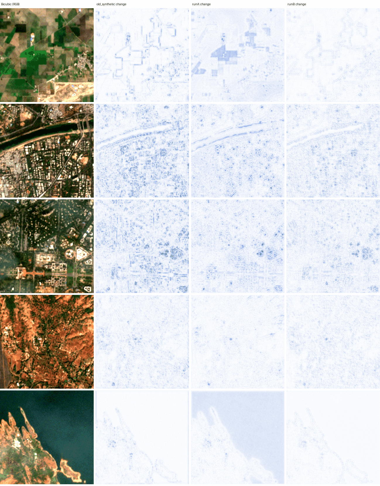

# Satellite Super-Resolution and Land-Cover Mapping

A working deep learning mini-project: real imagery -> 2x RCAN enhancement and real-pretrained land-cover detection -> maps and GIS exports.

**Team:** Shantanu Vasagadekar (1012412110), Aniruddha Kadam (1012412113), Shrihari Kshirsagar (1012412139).

The demonstration inputs in `demo_images/` are **genuine Sentinel-2 L2A crops** with measured B02/B03/B04/B08 bands and real georeferencing. Source dates, URLs, crop windows and checksums are recorded in [demo_images/manifest.json](demo_images/manifest.json).

The default land-cover detector combines **Hugging Face SegFormer-B0 and OpenEarthMap SparseMask**, pretrained on real labeled imagery. It detects from the original image and applies NIR checks only to measured satellite bands. Roads, buildings, vegetation, water, bare land and developed space remain distinct. The fixed eight-image LoveDA audit improved from **77.17% to 79.80% pixel accuracy**; the requested 85% threshold is **not met**. See [Hugging Face integration and full limitations](HF_MODEL.md). No accuracy guarantee applies to arbitrary uploads.

The app's RCAN (`checkpoints/demo/rcan.pt`) is **trained on real image pairs**: Sentinel-2 10 m patches matched with same-day VENµS 5 m images (SEN2VENµS dataset, 17 training sites). On two held-out Indian sites it beats bicubic by a small margin: **+0.20 dB PSNR, better on 83% of 13,039 patches**. It is also the only model tested that beats bicubic on the Indian reduced-scale benchmark (+0.20 dB, 38 of 42 scenes). It keeps Sentinel-2's contrast and brightness. See [Real-data RCAN training](#real-data-rcan-training-sen2venµs). Earlier models are kept for comparison: `rcan_synthetic.pt` (procedural data, below bicubic on real images) and `rcan_runA.pt` (first real-data run, which flattened contrast). The optional U-Net is still trained on procedural scenes only.


## Run the application

Python 3.10 or newer is required. From this project directory:

```powershell
python -m pip install -r requirements.txt
python L1BSR-GUI.py
```

The `checkpoints/demo/rcan.pt`, `landcover_real.pt` and `unet.pt` files are already trained. The GUI loads the selected detector automatically when processing starts. **CPU is the default**, including on computers with a GPU. Leave **Run without GPU (CPU)** checked near the top of the sidebar to run the complete enhancement, detection and export pipeline on a normal laptop. Uncheck it to use an available NVIDIA CUDA GPU. Without CUDA, the toggle remains checked and disabled, and the app explains that it is running on CPU. PyTorch must load before PyQt on Windows (the application handles this).

For your friend's Windows laptop, copy the project folder including `checkpoints/` and `demo_images/`, install 64-bit Python 3.10 or newer, then double-click **setup_cpu.bat** once and **run_app.bat** to launch. Setup creates a local `.venv-cpu` and installs the tested PyTorch 2.11 CPU build from the [official PyTorch CPU wheel index](https://pytorch.org/get-started/previous-versions/). A CUDA installation or NVIDIA driver is not needed. Internet is needed for setup; the included samples and models run offline afterward. Create the environment on each laptop rather than copying a virtual environment from another machine.

Switch devices only while idle. The app loads both replacement models before committing, preserves the selected image and chosen model folder, clears old processed results on success, and restores the previous device/results if loading fails. Re-run **Run all** after switching. CPU execution uses at most four threads to avoid excessive thread-pool overhead on small tiles. CPU processing can take longer than GPU processing; start with the included 256x256 crops.

1. Use **Choose image** above the preview, **Open image** in the sidebar, or the sample list. The chooser opens the demo folder with shortcuts to Downloads and Pictures, and remembers your selected folder.
2. Press **Run all (enhance + map)** to produce every result. You can also use **Enhance (2x)** and **Detect** separately.
3. Use Original, Enhanced, Compare, Map, Map on photo and Scores views. Compare shows the original, the RCAN result and a **change-vs-bicubic map** (darker blue = RCAN changed the pixel more, up to 0.05 reflectance). A change shows where the model acted; it is not proof of real detail. Enhanced PNG, JPEG and GeoTIFF exports are labelled as derived imagery in their metadata (`derived_product=true` in GeoTIFF tags).
4. The **Downloads** panel below the preview has direct buttons for image PNG/JPG, map PNG/TIF, GeoTIFF, the current view, scores PNG, report and **All results ZIP**. It remains visible at the minimum window size. GeoTIFF requires a georeferenced source.
5. Leave **Combined real models** selected for actual uploads. **Hugging Face SegFormer (fast)** uses less processing time; **SparseMask (previous model)** and **U-Net experiment / custom model** preserve the earlier workflows. Changing this option clears stale maps while keeping enhancement. The sample list includes fine-resolution Palu for roads and buildings.
6. Use **Choose model folder** with `rcan.pt`, `landcover_real.pt` and the `hf_segformer/` subfolder for the combined detector. HF alone needs `rcan.pt` and `hf_segformer/`; synthetic mode needs `rcan.pt` and `unet.pt`. Missing real weights raise an error rather than silently substituting synthetic weights.

Processing runs in a worker thread. Large inputs use overlapping inference tiles to bound accelerator memory. Tile context and RCAN channel attention can produce small differences from whole-image inference.

Inference inputs are capped at 1024 pixels on their longest side. Larger rasters are resampled while preserving their footprint and updating the affine transform. Use smaller geographic crops when you need to preserve native pixel spacing.

## Real-data RCAN training (SEN2VENµS)

The app's RCAN was trained on SEN2VENµS (Michel et al., 2022, *Data* 7(7):96; Zenodo record 6514159, CC BY-NC 4.0): Sentinel-2 10 m B02/B03/B04/B08 patches (128x128) paired with VENµS 5 m patches (256x256) acquired the same day. No site appears in two splits:

| Split | Sites | Patches |
| --- | --- | ---: |
| Train | ANJI, ATTO, BAMBENW2, ES-LTERA, ESGISB-1, ESTUAMAR, FGMANAUS, FR-LQ1, JAM2018, K34-AMAZ, LERIDA-1, MAD-AMBO, NARYN, SO2, SUDOUE-4, SUDOUE-5, SUDOUE-6 | 41,704 |
| Validation | ALSACE | 2,647 |
| Test | BENGA (West Bengal, India), KUDALIAR (Telangana, India) | 13,039 |

```powershell
python download_sen2venus.py      # the 20 sites above; resumable, MD5-checked, ~37 GB
python prepare_sen2venus.py       # -> datasets/sen2venus_npy, with per-patch shift and radiometry
python train.py --task sr --data datasets/sen2venus_npy --output checkpoints/real/runB_s42 --epochs 25 --early-stop 6 --batch-size 16 --crop 96 --lr 1e-4 --seed 42
python evaluate_sen2venus.py --models old_synthetic=checkpoints/demo/rcan_synthetic.pt runA=checkpoints/demo/rcan_runA.pt runB=checkpoints/demo/rcan.pt --sen2sr --limit 0
python compare_sr_models.py --rcan checkpoints/demo/rcan.pt --output results/sr_comparison_runB.json
python plot_compare_striping.py old_synthetic=checkpoints/demo/rcan_synthetic.pt runA=checkpoints/demo/rcan_runA.pt runB=checkpoints/demo/rcan.pt
```

The architecture is the same small RCAN as before (32 features, 3 residual groups x 4 blocks, bicubic skip, under 1 M parameters), so CPU and ONNX speed are unchanged.

**Two problems with the raw pairs, and how training handles them.** A first run (Run A, kept as `rcan_runA.pt`) scored well against VENµS but flattened Sentinel-2 contrast by 5-25% on Indian scenes. Two things caused this:

1. **Misregistration.** VENµS and Sentinel-2 are offset by fractions of a 5 m pixel (training sites: ~0.3-0.5 px on average). With a leftover sub-pixel offset, blurring lowers the loss. `prepare_sen2venus.py` estimates each patch's shift to 1/8 pixel, and the loss compares the prediction with the reference after applying exactly that shift (`models/alignment.py`).
2. **Radiometry.** At every scale from 10 to 40 m, VENµS images have 5-9% less contrast than Sentinel-2 in all four bands. That is a sensor difference, not detail, and a model trained on raw VENµS learns to flatten Sentinel-2. Each reference patch is rescaled per band to Sentinel-2's mean and contrast, measured at 40 m. The model therefore learns VENµS's fine spatial detail on Sentinel-2's radiometry.

The loss is L1 after alignment, with each band's mean offset removed. An RMSE term keeps the output, smoothly downsampled to 10 m, equal to the Sentinel-2 input. This anchors brightness, which the aligned loss alone ignores. A strict 2x2-mean constraint (`--consistent`) was also tried; it stayed below bicubic on validation and is off by default. Training ran on an RTX 5050 Laptop GPU (bf16, ~3 min/epoch), with early stopping on validation. Three seeds were trained; the one with the lowest validation loss (seed 42, epoch 5) is in the app.

**Held-out test sites** (all 13,039 patches; data range 10000; `results/sen2venus_test_full.json`). *Raw* compares with VENµS as it is. *Aligned* applies the patch's sub-pixel shift (estimated once from bicubic, the same for every method) and removes band offsets. *Harmonised* additionally puts the reference on Sentinel-2 contrast. Harmonised is the main score, because the app works on Sentinel-2 data.

| Method | Harmonised PSNR gain vs bicubic | Patches better | Aligned gain | Raw gain | SSIM (harm.) | SAM (harm.) |
| --- | ---: | ---: | ---: | ---: | ---: | ---: |
| Bicubic (40.54 dB) | 0 | n/a | 0 | 0 | 0.9684 | 1.896° |
| Synthetic RCAN | −0.26 dB | 2% | −0.25 dB | −0.25 dB | 0.9659 | 1.965° |
| Run A | +0.12 dB | 69% | +0.51 dB | +0.10 dB | 0.9706 | 1.779° |
| ESA SEN2SRLite (4x, averaged to 5 m) | −0.04 dB | 31% | −0.06 dB | −0.07 dB | 0.9679 | 1.875° |
| **Run B (app)** | **+0.20 dB** | **83%** | +0.18 dB | **+0.11 dB** | 0.9703 | 1.804° |

Run A wins the *aligned* score because it learned VENµS's lower contrast, which matches the raw reference but is wrong for Sentinel-2 input. Per site, Run B's harmonised gain is +0.34 dB on KUDALIAR but only +0.03 dB on BENGA.

**Indian reduced-scale benchmark** (42 real Sentinel-2 scenes: each 10 m image area-averaged to 20 m, upsampled back and scored against the real 10 m image; `results/sr_comparison_*.json`):

| Method | PSNR gain vs bicubic | Scenes better | Output averaged back to 10 m vs input (PSNR) | Edge energy vs bicubic |
| --- | ---: | ---: | ---: | ---: |
| Bicubic | 0 | n/a | 53.6 dB | 1.00 |
| Synthetic RCAN | −0.63 dB | 2 / 42 | 55.1 dB | 2.95 |
| Run A | −1.57 dB | 0 / 42 | 43.9 dB | 0.86 |
| ESA SEN2SRLite | −0.12 dB | 15 / 42 | 54.5 dB | 2.39 |
| **Run B (app)** | **+0.20 dB** | **38 / 42** | **54.7 dB** | 1.70 |

Seed spread for Run B: +0.19 to +0.21 dB on the test sites, and +0.20 to +0.28 dB on the reduced-scale benchmark (seeds 42, 1, 2).

**Compare view.** `docs/compare_striping.png` shows the change-vs-bicubic map on the five demo scenes. The synthetic RCAN's regular 2-pixel stripes (striping score 0.034) are gone in Run B (0.0012). Run A's broad shifts over water and fields are gone too: Run B changes only edges and features (mean change 22 vs 31 reflectance units).



**Limits.** The gains are small (about 0.1-0.3 dB), as the literature expects at 2x. VENµS is a different sensor, so this measures "closer to a real 5 m image after correcting known sensor differences", not recovery of objects smaller than 10 m. The harmonisation and alignment are estimated from the data and are themselves approximations. Only two test sites exist in India, and the gain varies between them. The reduced-scale benchmark uses a synthetic area-average degradation. Output remains derived imagery and is labelled as such in exports.

## Reproduce the synthetic learning experiment

```powershell
python train.py --demo --epochs 30 --samples 128 --output checkpoints/demo
python predict.py --demo --output outputs/synthetic_experiment
python plot_training.py
python -m pip install -r requirements-dev.txt
python -m unittest discover -s tests -v
```

Training uses 128 scenes, with 32 separate validation scenes and 32 separate test scenes. The three splits use disjoint random seeds. Each scene has 64x64 four-band HR imagery and five-class labels; LR is generated using antialiased bicubic downsampling to 32x32. Adam trains RCAN with L1 loss and U-Net with cross-entropy. The best checkpoint for each task is selected by validation loss. The test set is evaluated once after training. Results and all epoch losses are saved in `training_report.json`.

This section describes the original synthetic experiment. Its RCAN is kept as `checkpoints/demo/rcan_synthetic.pt` (ONNX: `checkpoints/demo/rcan_synthetic.onnx`); the U-Net in `checkpoints/demo/unet.pt` and `training_report.json` come from this run. The included run used an NVIDIA GeForce RTX 3070 Ti Laptop GPU. Exact package versions are recorded in `requirements-tested.txt` and the training report. Floating-point results may differ across platforms.

| Held-out synthetic test metric | Bicubic | Trained RCAN |
| --- | ---: | ---: |
| PSNR (data range 10000) | 30.08 dB | 35.74 dB |
| SSIM | 0.8928 | 0.9717 |
| Spectral angle | 5.024 degrees | 2.391 degrees |

The **RCAN -> U-Net** pipeline achieved **98.13% pixel accuracy** and **94.38% mean IoU** on those synthetic test scenes. These results apply to this generator and do not establish real satellite performance. U-Net is trained on HR imagery; its full pipeline test uses RCAN predictions, so reconstruction errors are included.


## Use real datasets

Use co-registered B02, B03, B04 and B08 imagery, in that order, with **uint16 reflectance scaled by 10000**. Single-channel GeoTIFF masks use these IDs:

| ID | Class |
| --- | --- |
| 0 | Buildings |
| 1 | Roads |
| 2 | Vegetation |
| 3 | Water |
| 4 | Bare land |
| 255 | Unlabeled / ignored |

Split by independent geographic scene **before** extracting patches. Keep overlapping areas out of different splits. HR and masks must have the same dimensions, CRS and transform. Measured LR imagery must cover the exact same footprint at half the HR width and height. If measured LR is unavailable, the preparation script generates degraded LR; this evaluates reconstruction under the chosen degradation, rather than recovery of independently observed spatial detail.

Prepare this structure (each `.tif` in `hr` contains all four bands):

```text
raw_data/
  train/
    hr/scene_001.tif
    masks/scene_001.tif
    lr/scene_001.tif     # optional
  val/
    hr/scene_002.tif
    masks/scene_002.tif
    lr/scene_002.tif     # optional
  test/
    hr/scene_003.tif
    masks/scene_003.tif
    lr/scene_003.tif     # optional
```

Use valid imagery crops of the same dimensions within each batch. HR dimensions must be even and at least 16x16. Imagery NoData must be cropped out; labels may contain 255. Raster scale/offset metadata is applied first and interpreted as physical reflectance. Untagged floating-point reflectance with a maximum <=1.5 is converted to the integer scale; other values are treated as digital numbers. Supply reflectance in the documented band order and verify product-specific units. Preparation supports both .tif and .tiff and publishes only after every split has validated.

```powershell
python prepare_dataset.py --input raw_data --output datasets/satellite
python train.py --data datasets/satellite --epochs 100 --batch-size 8 --output checkpoints/real
python predict.py --image your_four_band_scene.tif --models checkpoints/real --output outputs/real
```

You may also supply NPZ files directly inside `train/`, `val/` and `test/`. Each file contains `hr` (2H x 2W x 4 uint16), `lr` (H x W x 4 uint16, optional), and `mask` (2H x 2W class IDs). The code validates layout and IDs; the user must verify source provenance, class definitions and geographic separation.

For inference on separate single-band files:

```powershell
python predict.py --bands B02.tif B03.tif B04.tif B08.tif --models checkpoints/real --output outputs/scene
```

The GUI's **Open four satellite bands** button also supports aligned individual rasters.

## Evaluation and geographic interpretation

- PSNR, SSIM and SAM in the training report use held-out HR ground truth. Perfect PSNR is capped at 100 dB for finite report serialization. SSIM uses a 7x7 uniform window, averaged across bands. SAM excludes both-zero background; a single-zero spectrum receives 90 degrees.
- The GUI has no HR reference. Its metrics measure **similarity to bicubic**, not reconstruction accuracy. Higher edge energy measures sharpness and does not prove recovery of real structures.
- Softmax scores are uncalibrated. The Scores view shows the score for each output label, not validated confidence or a ground-truth error map.
- PNG/JPEG and ordinary RGB TIFF images have estimated NIR for the four-band enhancement contract. The real detector uses their original RGB alone; no spectral corrections use estimated NIR. Synthetic-detector maps on RGB remain illustrative. RGBA alpha is never treated as measured NIR.
- Ordinary images retain no invented CRS. Geographic area is unknown. Projected rasters use the affine determinant and CRS unit conversion to calculate pixel area. Area remains unavailable for geographic latitude/longitude grids.
- GeoTIFF exports preserve source CRS, extent, band descriptions and validity masks. Pixel spacing halves for 2x output. This changes sampling, without demonstrating twice the real spatial resolving power.
- Label GeoTIFFs include a class palette, with 255 as NoData; class 0 remains a valid building label. The synthetic sample's georeference is illustrative.
- Four bands support NDVI and green/NIR NDWI. Red/NIR contrast is included as a feature but is not NDBI; SWIR is required for NDBI.
- Missing real-detector checkpoints raise an error. The synthetic detector can explicitly use a spectral-rule baseline when weights are absent. Invalid or incompatible checkpoints raise an error instead of silently accepting partial weights.

## CPU-only ONNX super-resolution

The secondary GUI supports **super-resolution only**, using the exported model. It does not require PyTorch for inference.

```powershell
python -m pip install -r requirements-onnx.txt
# Conversion also requires the main PyTorch dependencies:
python convert_to_onnx.py --checkpoint checkpoints/demo/rcan.pt --output rcan_model.onnx
python L1-BSR-GUI-ONNX.py
```

An exported `rcan_model.onnx` is included. The conversion script checks the ONNX model and verifies numerical parity with PyTorch on three input sizes, including a single pixel. Input band order and normalization are recorded and checked by the ONNX GUI. The ONNX GUI accepts ordinary images and four-band TIFFs, processes overlapping tiles in a worker, and supports PNG/JPEG, GeoTIFF and JPEG + JGW + PRJ exports. Replacing any image, band or model invalidates previous outputs.


## Project files

- `models/rcan.py`: channel attention, residual groups, PixelShuffle and checkpoint-backed inference.
- `models/unet_segmentation.py`: eight-feature U-Net, class probabilities and optional morphology.
- `models/real_landcover.py`, `models/oem_sparsemask/`: real-pretrained detector, native-image inference, channel mapping and measured-NIR checks.
- `REAL_ACCURACY.md`, `evaluate_real_accuracy.py`: real-reference results and their limitations.
- `models/common.py`: preprocessing contracts, strict checkpoint checks and tiled inference.
- `models/evaluation_metrics.py`: reconstruction metrics, confusion matrices and IoU.
- `data.py`, `prepare_dataset.py`, `train.py`: data generation, real-data conversion and learning.
- `predict.py`: complete command-line inference and exports.
- `geo_io.py`: raster alignment, validity masks, transforms and class exports.
- `PROJECT_REPORT.md`: methods, measured results and limitations.
- `tests/test_pipeline.py`: model, metrics, raster and asynchronous GUI regression checks.
- `download_sentinel_demo.py`: public Sentinel-2 crop downloads and provenance.
- `tests/test_real_satellite.py`: real-scene radiometry, metadata and both GUI/export workflows.
- `tests/fixtures/formats/`: generated software format fixtures, outside the real demonstration dataset.

The existing presentation is preserved. Use `PROJECT_REPORT.md` and the measured training results to update any older presentation claims about pretrained models or real-world accuracy.

## Real satellite demonstration and audit

`demo_images/` contains **five genuine Sentinel-2 L2A scenes**, downloaded from the [public Earth Search Sentinel-2 COG archive](https://registry.opendata.aws/sentinel-2-l2a-cogs/). Each is a 256x256 native 10 m crop (2.56 km across), with measured B02/B03/B04/B08 uint16 bands, original UTM georeferencing, calibration and validity masks. All inputs and provenance together occupy about 3.9 MB.

| Scene | Acquisition UTC | Area |
| --- | --- | --- |
| Urban | 2023-12-05 | Central New Delhi |
| Agriculture | 2023-12-03 | Farmland east of Ludhiana, Punjab |
| Vegetation | 2023-12-30 | Western Ghats near Koyna |
| Water | 2024-02-28 | Pavana Reservoir |
| Mixed | 2024-02-28 | Pune city and the Mula-Mutha river |


Launch `python L1BSR-GUI.py`, select a **Sentinel-2** entry from the sample list, and press **Run all**. Open the next real scene immediately without restarting. Separate aligned files are in `demo_images/satellite_bands/<area>/`. No generated scenes, screenshots or ordinary photographs appear in the demo chooser.

The image chooser uses an explicit starting directory and shortcuts rather than leaving you at My Computer. It remembers the last chosen image folder. Save dialogs start in Downloads and remember the last save folder. PNG, JPEG, TIFF, BMP and WebP have individual filters.

Use **Run all** for a complete result, then **All results ZIP** to download the original/enhanced images, land-cover map, overlay, score image and NumPy arrays, raw four-band enhancement, Markdown and JSON reports. Georeferenced inputs also include enhanced/class GeoTIFFs and JPEG world-file/CRS sidecars. ZIP publication is atomic and runs in a worker. **Current view** can download Compare, Map on photo, or any other displayed view as PNG.

The selected Earth Search COGs already have their BOA offset applied. Their effective offset is zero; subtracting the original JP2 offset again would corrupt the spectra. The downloader records the original STAC values and effective calibration. Original source COG DN values are preserved without synthesis or resampling. SCL is used for quality screening; it is not five-class ground truth.

```powershell
# Included real scene, with full CLI outputs:
python predict.py --image demo_images/sentinel2_urban_delhi_2023-12-05.tif --output outputs/real_satellite/urban_delhi
# Download another copy into an EMPTY directory:
python download_sentinel_demo.py --output new_demo_images
```

CLI prediction also defaults to CPU. Pass `--device cuda` to opt into CUDA. Real-data training accepts `--device cpu` for a laptop, though larger training runs can be slow.

Source item JSON, band URLs, acquisition dates, crop windows, native grids, calibration and SHA-256 values are in `demo_images/sources/` and `demo_images/manifest.json`. Reports and GeoTIFF exports preserve acquisition/source attribution. See `demo_images/README.md` for attribution and usage. These are real inference/workflow inputs; no independent Sentinel-2 labels or HR reference are included. The default detector is real-pretrained, but its fine-resolution training differs from these scenes. Independent accuracy on these locations is not established.

Uploads validate the actual file format, complete decoding, dimensions and band layout. Empty, corrupt, truncated, mislabeled, unsupported, entirely transparent and entirely NoData inputs are rejected while preserving the previous valid scene. Animated WebP and multi-page TIFF are deliberately unsupported; export a still frame first. Ordinary photos have a 40-million-pixel decode limit and all inference inputs are resized to at most 1024 pixels on their longest side.

Valid pixels alone determine display stretching and similarity metrics. Before/after views reuse the same display bounds. PNG outputs preserve invalid pixels as transparency, label rasters use 255 as NoData, and GeoTIFF validity masks are internal. Image/report/checkpoint/ONNX writes are staged before replacement. JPEG world files and CRS sidecars are committed together; command-line output sets roll back on commit failure and remove stale generated GeoTIFFs when the next input has no CRS.

The 26 generated format fixtures now live in `tests/fixtures/formats/`, outside the demonstration dataset. They cover PNG/JPEG/BMP/WebP, palette, alpha, EXIF, CMYK, 16-bit, tiny and large inputs. `generate_demo_images.py` regenerates only these software fixtures and refuses to write into `demo_images/`.

The regression suite exercises all five real scenes through both GUIs and geographic exports, alongside format handling, repeated chooser/error recovery, memory, backend parity, upload rejection, failed writes, CLI reuse and custom-dataset training. See `AUDIT_REPORT.md` and `audit_results.json` for the recorded run. Tests validate software behavior and source-data preservation, not real-world reconstruction/classification accuracy.

The earlier CPU update passed all **71 tests** in the CUDA-capable environment and **69 applicable tests** in a fresh CPU-only installation (two CUDA-only checks skipped). Seven checks were added for the real detector: the full suite passed **78/78** in the CUDA-capable installation and **76/76 applicable checks** in the CPU-only build, with two expected GPU skips. Final results are in `real_detector_audit.json`. All five real samples are processed and exported on CPU. `requirements-cpu-tested.txt` records the independent installation. The new detector adds processing time; allow several seconds for small scenes and longer for large inputs.

## Submission and offline showcase

`SHOWCASE_GUIDE.md` contains preparation steps, a five-minute demonstration and accurate answers about reconstruction, predicted classes and evaluation. `showcase/` contains CPU outputs for all five genuine scenes, individual result ZIPs, and an original/enhanced/map/overlay overview. The real detector substantially reduces the reservoir-as-road error. Difficult small rivers, vegetation and building-like farmland predictions remain; `REAL_ACCURACY.md` records all reference comparisons and limitations.

```powershell
# Regenerate the real-scene results and verified source/results archive:
python prepare_showcase.py
python package_submission.py
```

`submission/L1BSR_Submission.zip` includes source, tests, license, checkpoints, ONNX model, real imagery and provenance, current reports, launchers and offline showcase results. It excludes local environments, unrelated files and the older unreviewed slide deck. Extract on the demonstration laptop and run setup_cpu.bat before the event while internet is available.
