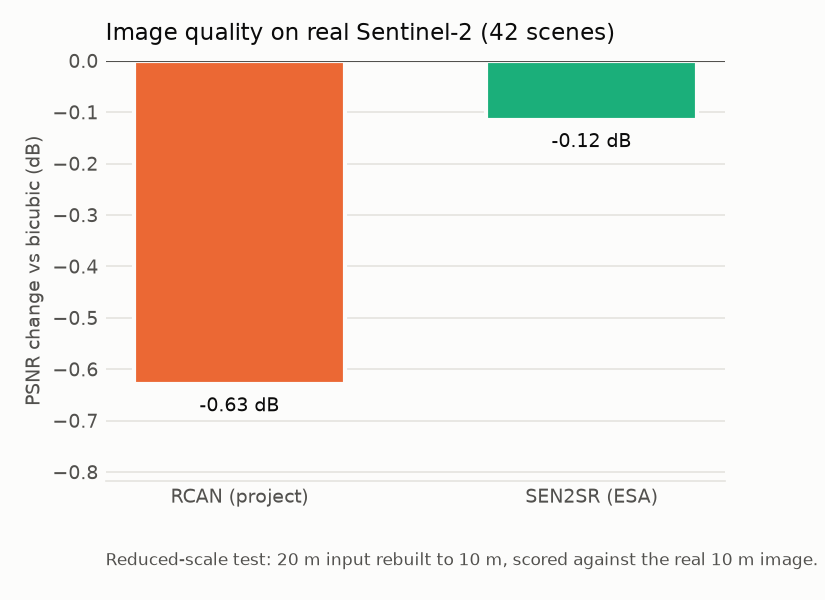
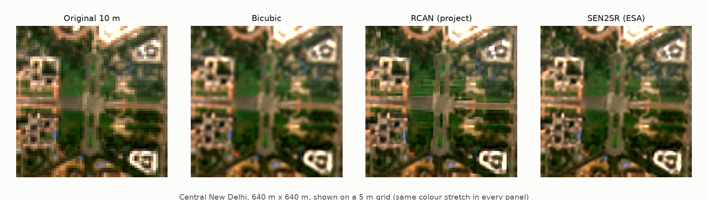

# Does super-resolution help? Results on real Sentinel-2

October 2026. Experiments on **real** Sentinel-2 imagery compare plain bicubic interpolation, this project's RCAN and ESA's SEN2SRLite (trained on real Sentinel-2/NAIP pairs). Raw numbers: `results/sr_comparison.json`, `results/mapping_experiment.json`, `results/sen2venus_test_runA.json`.

**Which RCAN?** The project has had two RCANs with the same small architecture:
- **Synthetic RCAN** (`checkpoints/demo/rcan_synthetic.pt`): trained on procedural scenes. It was the app model when Experiments 1 and 2 ran, so those results describe it.
- **Real RCAN** (`checkpoints/demo/rcan.pt`, the current app model): retrained on real Sentinel-2 10 m / VENµS 5 m pairs (SEN2VENµS). Only Experiment 3 has tested it so far. Experiments 1 and 2 **have not been re-run** with it.



## Short answer

- **Image quality, synthetic RCAN:** **worse than bicubic** on real images (−0.63 dB PSNR; better on only 2 of 42 scenes). It adds about 3x more fine detail than bicubic, but the detail doesn't match the real image. Visible striping appears below. SEN2SR roughly matches bicubic (−0.12 dB, slightly higher SSIM).
- **Image quality, real RCAN (Experiment 3):** against real VENµS 5 m images at two held-out Indian sites, it **beats bicubic by a small margin**: +0.47 dB PSNR after correcting for misregistration (+0.09 dB raw), better on 1,638 of 2,000 patches. The synthetic RCAN scores −0.29 dB on the same test. Retraining on real pairs fixed the main weakness, but the gain is small.
- **Mapping (synthetic RCAN):** the same U-Net trained on bicubic, RCAN or SEN2SR input gives **the same land-cover accuracy** (mean IoU 49.3%, 49.3%, 48.8%). All three beat the raw 10 m pixels by about 1–1.5 points. That gain comes from the smoother 5 m grid, which bicubic already provides, not from any model-added detail. With a 0.47 dB image gain and 10 m labels, the real RCAN is unlikely to change this, but it has not been measured.
- This matches the literature ([RELATED_WORK.md](RELATED_WORK.md) §5): super-resolution makes images look sharper far more than it makes maps better.



## Experiment 1: image quality (reduced-scale test, synthetic RCAN)

**Data:** 42 real Sentinel-2 L2A crops: 37 Indian sites from `scripts/download_mapping_benchmark.py` plus the 5 demo scenes. Neither model was trained on any of them.

**Method:** each real 10 m crop is area-averaged to 20 m. Each method upsamples it 2x back to 10 m and is scored against the real 10 m image. SEN2SR runs at 4x and is area-averaged by 2. Script: `scripts/compare_sr_models.py`.

| Method | PSNR (dB) | Change vs bicubic | Scenes better than bicubic | SSIM | Spectral angle (deg) |
|---|---:|---:|---:|---:|---:|
| Bicubic | 39.34 | 0 | n/a | 0.9366 | 1.74 |
| Synthetic RCAN | 38.71 | −0.63 | 2 / 42 | 0.9324 | 2.05 |
| SEN2SR (ESA) | 39.22 | −0.12 | 15 / 42 | 0.9412 | 1.78 |

**Native-scale checks** (real 10 m input → 5 m output, no reference image):

| Method | Consistency PSNR (output averaged back to 10 m vs input) | Fine detail vs bicubic |
|---|---:|---:|
| Bicubic | 53.6 dB | 1.0x |
| Synthetic RCAN | 55.1 dB | 2.9x |
| SEN2SR | 54.5 dB | 2.4x |

The synthetic RCAN stays consistent with its input yet adds the most "detail". Combined with the reduced-scale result, much of that detail is invented.

**Limits:** both models were built for 10 m input, so 20 m input is outside their training conditions. This tests detail recovery at a different scale, a standard but imperfect stand-in for a true 5 m reference. Experiment 3 adds the real cross-sensor test.

**Not yet done:** re-running this test with the real RCAN (`python scripts/compare_sr_models.py --rcan checkpoints/demo/rcan.pt --output results/sr_comparison_real_rcan.json`). The striping in the figure above comes from the synthetic RCAN; whether the real RCAN removes it has not been checked.

## Experiment 2: does SR input improve land-cover mapping? (synthetic RCAN)

**Data:** 37 Indian sites, each a 512×512 Sentinel-2 crop (2021-22 dry season) with ESA WorldCover 2021 labels in 6 classes: built-up, tree cover, shrub/grass, cropland, water/wetland, bare/sparse. Split by site: 24 train, 5 validation, 8 test (Hyderabad, Lucknow, Guntur, Bathinda, Wayanad, Hirakud, Jaisalmer, Bhubaneswar).

**Method:** one U-Net (the project's `SatelliteSegmentationNet`, 1.9 M parameters) trained from scratch separately on each input, all on a 5 m grid. Same labels, seeds (0, 1, 2), 1,200 steps, class weights and augmentation for every input. The checkpoint with the best validation mean IoU is scored once on the test sites. Script: `scripts/mapping_experiment.py`.

| Input | Overall accuracy | Mean IoU | Mean F1 | Mean IoU change vs bicubic (same seed) |
|---|---:|---:|---:|---:|
| Original 10 m (pixels repeated) | 71.0% ± 2.9 | 47.8% ± 2.2 | 59.7% | −1.5 (range −2.7 to +0.4) |
| Bicubic 2x | 73.5% ± 1.9 | 49.3% ± 1.6 | 61.1% | n/a |
| RCAN 2x | 73.2% ± 2.8 | 49.3% ± 2.1 | 61.2% | 0.0 (range −0.8 to +1.0) |
| SEN2SR (4x → 5 m) | 72.6% ± 2.1 | 48.8% ± 1.8 | 60.7% | −0.5 (range −0.8 to −0.4) |

± is the standard deviation over 3 seeds.

Per-class F1 (mean of 3 seeds):

| Class | Original | Bicubic | RCAN | SEN2SR |
|---|---:|---:|---:|---:|
| Built-up | 0.869 | 0.874 | 0.873 | 0.875 |
| Tree cover | 0.661 | 0.711 | 0.701 | 0.694 |
| Shrub / grass | 0.185 | 0.174 | 0.173 | 0.177 |
| Cropland | 0.313 | 0.350 | 0.359 | 0.341 |
| Water / wetland | 0.914 | 0.917 | 0.918 | 0.911 |
| Bare / sparse | 0.642 | 0.641 | 0.646 | 0.643 |

**Reading it:** the differences between bicubic, RCAN and SEN2SR are smaller than the variation between seeds, so none is reliably better. The original 10 m input is slightly worse, mostly at the forested Wayanad site (53% vs 67% accuracy), where blocky 10 m pixels hurt. Shrub/grass and cropland are weak for every input, which is also true of global 10 m products.

**Limits:**
- WorldCover is itself a model output (about 75% accurate globally), not human ground truth.
- Its labels are 10 m, so it **cannot reward detail finer than 10 m**. This test shows SR doesn't help match a 10 m map; it cannot rule out gains that only finer labels would reveal.
- 8 test sites and 3 seeds is a small sample; confidence intervals are wide.
- Training was short (1,200 steps on CPU). Longer training would raise all scores, probably by a similar amount for each input.
- The RCAN input here is the **synthetic** RCAN. The real RCAN has not been run through this experiment.

## Experiment 3: real cross-sensor test (Sentinel-2 vs VENµS 5 m)

**Data:** SEN2VENµS test sites BENGA (West Bengal) and KUDALIAR (Telangana), 2,000 evenly spaced patches (897 and 1,103). Each 10 m Sentinel-2 patch is upsampled 2x and scored against a real VENµS 5 m image of the same place on the same day. Neither site was used in training or validation. Script: `scripts/evaluate_sen2venus.py`.

**Method:** VENµS and Sentinel-2 are misregistered by about one 5 m pixel and differ slightly in band response. "Compensated" scores remove the best integer shift within ±2 px and each band's mean offset before scoring, for every method equally (as in the PROBA-V challenge's cPSNR). "Raw" scores apply no correction.

| Method | PSNR raw (dB) | PSNR compensated (dB) | Gain vs bicubic (compensated) | Patches better than bicubic | SSIM compensated | Spectral angle compensated (deg) |
|---|---:|---:|---:|---:|---:|---:|
| Bicubic | 39.08 | 40.09 | 0 | n/a | 0.9664 | 1.97 |
| Synthetic RCAN | 38.83 | 39.80 | −0.29 | 6 / 2,000 | 0.9630 | 2.06 |
| **Real RCAN (app model)** | **39.17** | **40.55** | **+0.47** | **1,638 / 2,000** | **0.9697** | **1.83** |

Per site (compensated gain vs bicubic): BENGA +0.48 dB (811 / 897 patches better), KUDALIAR +0.46 dB (827 / 1,103). The synthetic RCAN is below bicubic at both sites (−0.22 and −0.36 dB).

**Reading it:** training on real pairs turns a model that was worse than bicubic into one that is consistently, if slightly, better. The gain is consistent across both sites and most patches, and the spectral angle improves too. It is still small: about half a decibel, in line with the literature's expectation that 2x SR of Sentinel-2 recovers limited real detail.

**Limits:**
- The gain without registration correction is only +0.09 dB. Part of the compensated gain may reflect the model learning VENµS's band response rather than spatial detail. The training loss removes mean offsets per band, which limits but does not rule this out.
- The checkpoint was selected at epoch 6 of 80. After that, the model kept improving on its 7 training sites but not on the validation site, so it is close to the limit of what this data and model size give.
- 2 test sites, both Indian. They are a good fit for this project but do not cover all landscapes.
- SEN2SR has not been scored on this test yet (`python scripts/evaluate_sen2venus.py --sen2sr ...` in the `requirements/research.txt` environment).

## Conclusions

1. The synthetic RCAN's gap was its **synthetic training data**. Retraining on real Sentinel-2/VENµS pairs closed it: the app's RCAN now beats bicubic on real imagery, by a small margin (Experiment 3).
2. For mapping, the app is right to classify the **original** image rather than the enhanced one ([LAND_COVER.md](LAND_COVER.md)).
3. The app's Compare view now shows a change-vs-bicubic map, and enhanced exports are labelled as derived imagery, so users can see where the model acted without mistaking it for measured detail.

## Reproduce

```powershell
py -3.14 -m venv .venv-research
.venv-research\Scripts\python -m pip install -r requirements/research.txt
.venv-research\Scripts\python scripts/download_sen2sr.py
.venv-research\Scripts\python scripts/download_mapping_benchmark.py
.venv-research\Scripts\python scripts/compare_sr_models.py
.venv-research\Scripts\python scripts/mapping_experiment.py --steps 1200 --eval-every 200 --seeds 0 1 2
.venv-research\Scripts\python scripts/plot_sr_results.py
```

Runtime on a CPU laptop (8 threads): about 5 minutes for the comparison and about 4.5 hours for the 12 mapping runs.

Experiment 3 needs the SEN2VENµS sites (~17 GB) and the training steps in the README ("Reproduce the training and evaluation"). Then:

```powershell
python scripts/evaluate_sen2venus.py --models old_synthetic=checkpoints/demo/rcan_synthetic.pt new_real=checkpoints/demo/rcan.pt
```

**Data credits:** contains modified Copernicus Sentinel data (2021–2024). ESA WorldCover 2021 (CC BY 4.0). SEN2SRLite by ESA OpenSR (MIT). SEN2VENµS (Michel et al., 2022; CC BY-NC 4.0).
